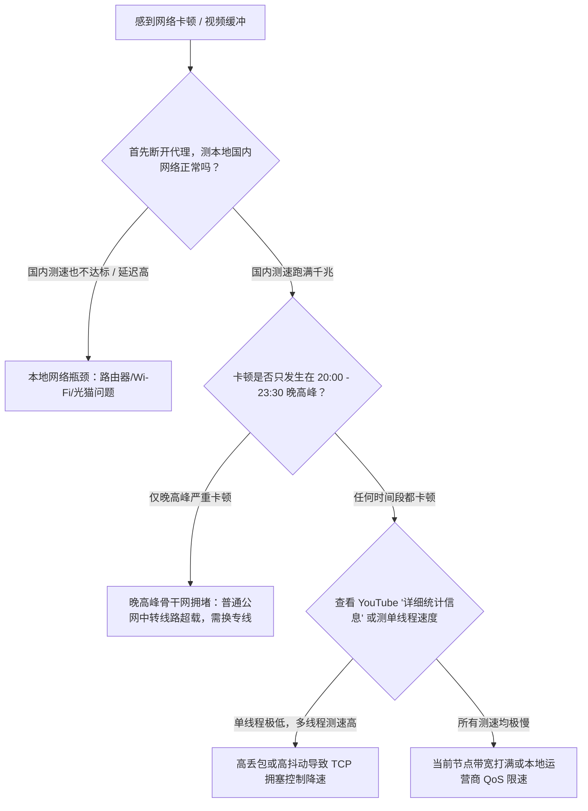

# 机场速度慢怎么办？如何判断问题出在哪里（网络、时段、节点与测速深度排查）

“明明家里装的是千兆光纤宽带，为什么连上机场看 YouTube 4K 还是频繁转圈圈？”  
“白天看视频飞快，一到晚上 8 点就卡成 PPT，到底是我家宽带不行还是机场不行？”

很多人遇到速度慢，第一反应就是在群里喷“机场又垃圾了”。但实际上，从你的设备到海外目标网站，中间跨越了 **家庭 Wi-Fi $\rightarrow$ 省市骨干网 $\rightarrow$ 机场中转入口 $\rightarrow$ 跨境隧道 $\rightarrow$ 海外机房 $\rightarrow$ 目标 CDN** 整整 6 个环节。任何一个节点出现瓶颈，都会导致体验暴跌。

本文将教你如何像网络工程师一样科学定位速度瓶颈，并提供立竿见影的调优方案。

---

## 瓶颈排查决策树：问题究竟出在哪？



---

## 维度一：排查本地网络与设备环境 (不要盲目甩锅)

在怀疑机场之前，先花 1 分钟排除本地物理环境的干扰：

1. **测试本地原生带宽**：
   彻底退出代理客户端，访问国内测速网站（如 `speedtest.cn`）。如果本地宽带连 100Mbps 都跑不满，或者延迟抖动达到几十毫秒，说明是光猫死机、Wi-Fi 穿墙信号弱或局域网有人在全速下载。
2. **5GHz Wi-Fi 与有线网线连接**：
   2.4GHz Wi-Fi 频段在居民区通常充斥着严重信道干扰，最大实际吞吐量往往很难突破 50Mbps。连接代理测速时，**请务必连接 5GHz Wi-Fi 频段或直接插千兆网线**。
3. **运营商差异 (电信 / 联通 / 移动)**：
   在中国大陆，不同宽带运营商的国际出口策略差异巨大：
   - **中国移动**：国际出口总带宽大，但在晚高峰对境外 UDP 流量及未备案连接实施极其严苛的 QoS 限速。
   - **中国电信**：普通 163 骨干网晚高峰国际出口丢包率可达 30% 以上，只有走专线（IEPL/IPLC）或 CN2 GIA 线路才能获得稳定高速。

---

## 维度二：时段与晚高峰骨干网拥堵

### 晚高峰效应 (20:00 - 23:30)

<NetSlowdownAnim scene="peak" />

中国大陆每天晚上 8 点至夜间 11 点半，是全国网民用网最高峰。
- **直连与公网中转机场**：
  这种机场依靠公共互联网的跨境出口。一到晚高峰，国际出口海缆拥挤不堪，丢包率会明显上升，哪怕连接正常，TCP 重传也会让视频频繁卡顿。
- **物理专线机场 (IEPL / IPLC)**：
  专线机场租用的是企业级内网隧道（例如深圳 $\rightarrow$ 香港独立光纤），不经过公网国际出口，因此**受晚高峰拥堵的影响通常小得多**（国内入口段仍可能受本地网络影响）。
- **判断依据**：
  如果你的机场每天只有晚上卡，白天飞快，且你买的是几块钱一月的“廉价公网中转”套餐，那么最有效的办法通常是**换成专线机场**。节假日和海缆故障导致的变慢，可以看 [机场为什么突然变慢（动图图解）](/blog/why-network-slow-peak-holiday-weather)。

---

## 维度三：测速误区——单线程 vs 多线程与 YouTube 统计

很多用户在 Speedtest 里测出了 500Mbps 的极速，但打开 4K 视频依然卡顿，原因在于没有分清**单线程速度**与**多线程速度**的区别。

### 1. 为什么多线程测速会“骗人”？
- **Speedtest 默认测速**：通常会开启 **16~32 个并发多线程**。哪怕单条连接丢包率很高，多条连接拼凑在一起依然能堆出好看的高带宽数据。
- **真实网页与流媒体播放**：YouTube、Netflix 播放视频流以及普通网页加载，本质上是**单线程传输**。如果线路丢包率高，TCP 拥塞控制算法会强制压低单线程传输窗口。

### 2. 如何看懂 YouTube 的真实连接速度？
右键点击正在播放的 YouTube 视频，选择 **“详细统计信息” (Stats for nerds)**：

```text
Connection Speed:    48200 Kbps   <--- 真实单线程下载带宽 (达到 40000 Kbps 即可流畅 4K)
Network Activity:    0 KB
Buffer Health:       18.4 s       <--- 视频缓冲区健康时长 (保持在 15s 以上流畅不卡顿)
Mystery Text:        s:8 t:154.2...
```

- 如果 `Connection Speed` 稳定在 **45,000 Kbps (约 45Mbps)** 以上，且 `Buffer Health`（缓冲区健康度）维持在 10 秒以上，说明播放 4K 60fps 没有任何压力。
- 如果该数值忽高忽低，甚至跌破 5,000 Kbps，说明该节点正在剧烈丢包。

---

## 维度四：节点排错与避坑建议

### 1. 避开全场扎堆的“01 号”或“第一排”节点
90% 的普通用户打开客户端后，默认选择排在最前面的“香港 01”或“日本 01”节点。这会导致这些节点被成千上万人同时挤爆，而排在靠后位置的“香港 06”或“台湾 02”负载却不到 10%。
> [!TIP]
> 遇到卡顿，先在节点列表中切换到**排序较靠后、倍率正常（1.0x）的节点**尝试。

### 2. 注意高倍率节点的带宽差异
某些机场为了节约成本，可能会限制高倍率节点的单机突发上限，或者某些 0.2x 低倍率节点本身就是高负载的大盘线路。根据需求挑选：看 4K 选低延迟高突发专线；下载大文件选大带宽直连节点。

---

## 提升速度的 5 大实操调优技巧

### 技巧 1：调优本地 MTU 参数（解决分片丢包）
很多家庭光猫开启 PPPoE 拨号后，实际 MTU 仅为 1492 或 1480。如果代理隧道的数据包超过物理 MTU，就会在网关处被强制二次拆包，引起严重延迟抖动与断流。
- 在 Clash 虚拟网卡设置或路由器代理中，将 MTU 调整为 **`1400` 或 `1380`**，可以显著改善视频缓冲停滞的问题。

### 技巧 2：开启客户端并发连接数与 Fast-Open
在支持的客户端（如 Clash Verge Rev 内核设置）中，开启针对 TCP 的优化选项，允许客户端并行建立多路复用连接（Muxing），降低握手延迟。

### 技巧 3：将代理模式改为“分流规则 (Rule)”而非“全局”
全局模式下，你电脑中的国内软件（微信、网易云音乐、迅雷下载）也会强行穿过海外代理节点，不仅浪费海外流量，还会挤占机场节点的有限吞吐量，拖慢外网速度。务必保持 **“规则模式 (Rule)”**。

### 技巧 4：采用“主副双机场”互备策略
任何单一机场都有机房上游网络维护或入口迁移的时刻。备有一条主力专线机场用于日常看 4K 和办公，搭配一个按量付费的不限时流量包作为备用，当主机场因特殊原因降速时，一秒无缝切换。

---

## 常见速度排查速查表

| 故障现象 | 最可能的原因 | 推荐解决动作 |
| :--- | :--- | :--- |
| **全天任何时候都慢，国内测速也慢** | 本地 Wi-Fi 干扰或宽带光猫故障 | 重启光猫/路由器，插网线改用 5GHz Wi-Fi |
| **仅晚高峰（20:00-23:30）严重卡顿** | 线路为廉价公网中转，国际出口海缆拥堵 | 换用原生内网专线（IEPL/IPLC）机场 |
| **测速几百兆，但 YouTube 4K 转圈** | 高丢包导致单线程 TCP 窗口受限 | 换排序靠后的节点，调节 MTU 至 1400 |
| **特定外网打不开/巨慢，其他正常** | 该落地机 IP 被目标站点限速/限流 | 切换其他国家或流媒体原生解锁节点 |

---

## 相关阅读与深度指南

- [节点有延迟但打不开网页排查指南](/blog/node-has-latency-cannot-open-webpage-fix)
- [机场订阅导入失败怎么办？按报错现象逐项排查手册](/blog/airport-subscription-import-failed-troubleshooting)
- [跨平台网络诊断与延迟排错深度教程](/guides/network-optimization)
- [MTU 参数调优与防断流实战手册](/guides/mtu-latency-tuning)
