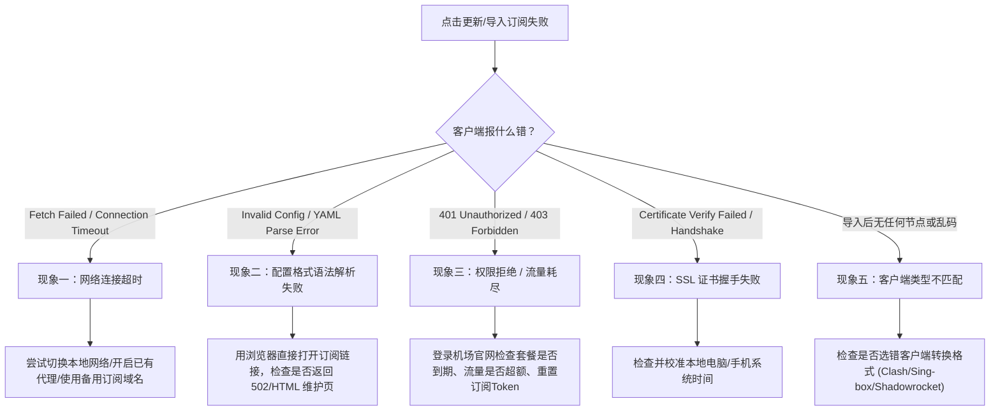

# 机场订阅导入失败怎么办？常见报错现象与逐项排查手册

购买了机场套餐后，很多新手在第一步“导入订阅”时就卡住了：点击“下载”或“更新订阅”，客户端弹出红色警告提示 **`Network Error`**、**`Fetch Failed`**、**`Invalid Config`** 或 **`401/403 Forbidden`**。

很多用户以为是机场跑路或客户端坏了，其实 **90% 以上的订阅导入失败都是因为网络解析、系统时间或格式转换** 导致的常规问题。本文梳理了最典型的报错现象，并提供标准化的排查步骤。

---

## 快速自检诊断流程

遇到订阅导入失败时，请先对照以下流程图快速定位故障层级：

---

## 现象一：网络连接超时 / Fetch Failed / Network Error

### 典型报错特征
- Clash Verge / Clash Meta：提示 `Fetch Failed: fetch failed` 或 `Connect timeout`。
- Shadowrocket (小火箭)：导入时进度条卡在 0% 或弹窗提示 `网络连接超时 (timed out)`。
- v2rayN：提示 `基础连接已经关闭: 发送时发生错误` 或 `无法解析此远程名称`。

### 核心原因
客户端在尝试访问机场的订阅分发服务器时，DNS 无法解析订阅域名，或者该订阅分发域名被本地宽带运营商拦截/阻断。

### 解决方案
1. **使用机场提供的“备用订阅域名”**：
   大型机场通常会在官网用户中心提供多条订阅链接（如“订阅 1”、“订阅 2 - 防封备用”、“CF 优选解析订阅”）。换用备用链接重新尝试。
2. **已有旧节点？开启代理辅助更新**：
   如果你的客户端里还有以前可用的节点，先开启“系统代理”，然后勾选客户端设置中的 **“通过代理更新订阅” (Update via Proxy)**，再点击更新。
3. **切换网络热点**：
   如果是家庭宽带（尤其是移动宽带或长宽等二级宽带），经常对订阅转换 API 实施域名劫持。尝试手机开启 5G 热点让电脑连接，通常能立刻成功。
4. **更换本地公共 DNS**：
   将电脑或手机的 DNS 修改为阿里公共 DNS (`223.5.5.5`) 或腾讯 DNSPod (`119.29.29.29`)，清除本地 DNS 缓存后再试。

---

## 现象二：Invalid Config / YAML 解析失败 / Format Error

### 典型报错特征
- 提示 `Invalid Config: yaml: line 1: did not find expected key`。
- 提示 `Error: Unexpected token < in JSON at position 0`。
- 导入后配置列表报错，无法加载出具体的节点列表。

### 核心原因
客户端期望接收一份合法的 YAML（Clash 格式）或 JSON 配置文件，但**机场服务器返回的其实是一张网页**。
这通常发生在：
1. 机场订阅转换服务器临时负载过高或崩溃，返回了 Cloudflare 的 `502 Bad Gateway` 或 `504 Gateway Timeout` HTML 错误页。
2. 机场处于维护状态或开启了 Cloudflare 盾（5 秒防 CC 人机验证），客户端脚本无法绕过验证码盾，直接把 HTML 网页源码写入了配置文件。

### 解决方案
1. **浏览器直接访问验证**：
   将订阅链接复制到浏览器地址栏中直接打开：
   - 如果网页显示 Cloudflare 盾、验证码，或者 `Bad Gateway 502`，说明是机场后端维护中，等待 10~30 分钟即可恢复。
   - 如果浏览器能下载下来一个包含 `proxies:` 文本的 `.yaml` 文件，说明订阅正常，可以直接在客户端选择“本地文件导入 (Import Local File)”。
2. **清理订阅链接中的中文与空格**：
   检查订阅链接中是否意外复制了空格、中文分号或特殊字符。

---

## 现象三：401 Unauthorized / 403 Forbidden / 流量超额

### 典型报错特征
- 提示 `HTTP 401 Unauthorized` 或 `HTTP 403 Forbidden`。
- 订阅更新返回 `Subscription has expired` 或 `User disabled`。

### 核心原因
机场服务器拒绝向当前请求颁发节点数据。

### 解决方案
1. **登录官网检查套餐状态**：
   - 检查套餐是否已经到期。
   - 检查当月总流量是否已经耗尽（部分机场超额后会直接切断订阅分发 API）。
2. **重置订阅 Token (安全防盗)**：
   如果你的订阅链接曾泄漏或疑似被其他人蹭网盗用，机场可能锁定了订阅。在官网用户后台点击 **“重置订阅信息 / 重置 Token”**，然后将重新生成的全新链接复制到客户端中导入。

---

## 现象四：SSL 证书验证失败 / Certificate Expired / Handshake Error

### 典型报错特征
- 提示 `x509: certificate has expired or is not yet valid`。
- 提示 `SSL handshake failed` 或 `Self-signed certificate in certificate chain`。

### 核心原因
客户端与机场订阅分发站建立 TLS 加密通信时，证书无法通过信任校验。
> [!IMPORTANT]
> **90% 的此类报错是因为电脑或手机的“系统时间不准”！**
> TLS 证书校验依赖精确的时间戳。如果本地系统时间与网络北京时间相差超过 2~3 分钟，TLS 握手就会被加密机制强制中断。

### 解决方案
1. **同步校准系统时间**：
   - **Windows**：打开设置 $\rightarrow$ “时间和语言” $\rightarrow$ “日期和时间” $\rightarrow$ 点击 **“立即同步”**。
   - **macOS**：系统设置 $\rightarrow$ “通用” $\rightarrow$ “日期与时间” $\rightarrow$ 开启“自动设置时间”。
   - **手机端**：进入系统时间设置，确认开启“自动设置时区与时间”。
2. **开启“跳过证书验证” (仅作为临时急救手段)**：
   在 Clash 或 v2rayN 订阅设置中，部分客户端有 `Skip Cert Verify` 或 `Insecure` 选项。若确属机场自签证书导致，可临时勾选该开关完成拉取。

---

## 现象五：客户端类型不匹配（Clash / 小火箭 / Sing-box 格式搞混）

### 典型报错特征
- 导入后节点名称全是一长串乱码 Base64 字符。
- 点击测速没有任何反应，无法启动核心。

### 核心原因
不同的客户端使用完全不同的配置语法规范：
- **Clash 系列 (Clash Verge Rev / Mihomo Party)**：需要包含 `proxies`, `proxy-groups`, `rules` 的 **YAML 格式**。
- **Shadowrocket (小火箭)**：原生支持 Base64 节点聚合链接。
- **Sing-box**：使用纯 JSON 语法树。

### 解决方案
登录机场官网的“仪表盘 / 用户中心”，在“一键订阅”或“便捷导入”菜单下，务必选择与你的客户端**精准对应**的格式：
- 如果你使用的是 Clash Verge Rev，请点击 **“导入到 Clash”** 或复制 **“Clash 订阅链接”**。
- 如果复制的是通用的 Base64 聚合链接，请在机场后台使用其自带的 **“订阅转换工具”** 转换为目标客户端格式后再导入。

---

## 常见客户端一键导入问题对照表

| 客户端名称 | 推荐导入方式 | 失败首选排查项 |
| :--- | :--- | :--- |
| **Clash Verge Rev** | 复制 Clash 订阅 URL $\rightarrow$ 订阅管理 $\rightarrow$ 粘贴导入 | 检查系统时间、开启“通过代理更新”、检查 YAML 语法 |
| **Shadowrocket (小火箭)** | 复制原生订阅 $\rightarrow$ 打开 App 自动弹窗添加 | 切换节点网络、检查外区 Apple ID 购买权限、改用扫码导入 |
| **Sing-box** | 复制 Sing-box 专有 JSON 订阅链接 | 确认机场支持 sing-box 1.10+ 最新规则格式 |
| **v2rayN** | 订阅分组 $\rightarrow$ 添加订阅链接 $\rightarrow$ 更新全部订阅 | 更新 Xray/v2fly 内核组件、检查系统代理模式开关 |

---

## 依然无法解决？三步终极自救方案

如果你逐一核对了上述 5 大现象仍然无法更新：

1. **改用“扫码导入”**：
   在手机端使用客户端自带的“扫一扫”功能，直接扫描机场用户中心页面生成的订阅二维码（绕过剪贴板编码截断问题）。
2. **手动下载配置文件离线导入**：
   在电脑浏览器中将订阅链接当成网址直接下载，保存为 `config.yaml` 文件。然后在 Clash 客户端中点击“新配置” $\rightarrow$ “本地文件导入”，直接拖入该文件即可免除在线请求。
3. **联系机场在线客服或工单**：
   提供你的 UID、报错截图以及网络运营商（如江苏电信 / 广东移动），机场运维人员通常能迅速判断是机房节点调度故障还是当前节点段遭遇了临时拦截。

---

## 相关阅读与实战指南

- [Clash Verge Rev 完整安装与订阅导入实操教程](/blog/clash-verge-rev-install-subscription-guide)
- [Android 手机如何导入机场订阅教程](/blog/android-airport-subscription-guide)
- [iPhone 苹果手机如何使用机场订阅教程](/blog/iphone-ios-airport-subscription-guide)
- [节点有延迟但打不开网页排查指南](/blog/node-has-latency-cannot-open-webpage-fix)
