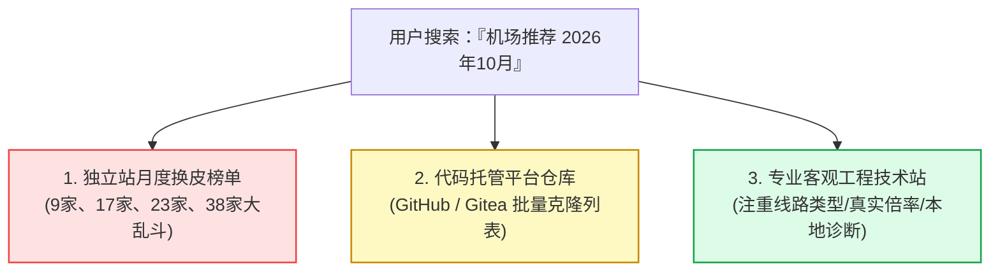

# 每日监控简报 · 2026-10-29：高校VPN收紧传闻、欧盟反盗版草案波及VPN与黑五促销抢跑

<div class="site-breadcrumbs">
  <a href="/">首页</a>
  <span class="sep">/</span>
  <a href="/blog/">博客文章</a>
  <span class="sep">/</span>
  <span class="current">每日监控简报 · 2026-10-29</span>
</div>

> [!NOTE] 简报说明
> 本文为本站持续发布的 **「机场 / 梯子 / VPN 每日情报与监控简报」**。严格统计过去 24 小时内的最新行业动态；为保证简报的完整性与实用参考价值，同步收录了近 7 天内具有较高关注度、与跨境网络加速生态密切相关的核心补充事件，所有涉及政策与未经独立核实的报道均已明确标注来源。

---

## 一、今日核心要点速览 (Executive Summary)

整体来看，今日行业新增动态以**政策监管与商业促销**为主，开源内核与客户端协议方面过去 24 小时内未见破坏性或大版本更新发布：

```
┌─────────────────────────────────────────────────────────────────────────────┐
│ 1. [监管] 媒体报道国内多所高校收紧 VPN 管控并要求签署承诺书 (来源外媒未独立核实)│
│ 2. [政策] 欧盟版权改革草案拟引入全欧反盗版封锁令，行业担忧 VPN 承担过滤义务 │
│ 3. [大促] 海外商业 VPN 提前打响黑五战：Proton VPN 推出年付与两年期大促特惠  │
│ 4. [生态] 主流内核与客户端（Clash Verge Rev、mihomo、sing-box）运行稳定无新版│
│ 5. [SERP] 「机场推荐 2026年10月」搜索引擎结果被月度榜单页与代码托管仓库占据 │
└─────────────────────────────────────────────────────────────────────────────┘
```

---

## 二、全球政策与监管动态 (Policy & Regulation)

### 1. 国内高校收紧 VPN 管控与承诺书签署传闻 (10/28)
- **动态来源**：据海外媒体 [The Epoch Times](https://www.theepochtimes.com/china/chinese-universities-tighten-vpn-restrictions-ahead-of-key-ccp-meeting-6109639) 报道，近期国内多所高校在重要会议期间进一步收紧了校园网环境下的翻墙网络管理。
- **报道细节**：报道称部分高校要求学生签署网络安全承诺书，校园网出口加强了对非正规 VPN 流量的审计，并以校纪处分等手段相提示。
- **客观评估**：
  - *注：该消息来自外媒报道，目前未经独立第三方核实。*
  - 但从网络工程常识来看，国内高校教育网（CERNET）出口向来部署有更严格的深包检测（DPI）与日志审计系统。在特殊敏感时间节点，教育网与校园 WiFi 往往会成为审查重点。
  - **建议**：在校学生与教职工若需查阅学术资料，应尽量避免直接在校园直连公共 Wi-Fi 下使用没有混淆特征的老旧协议；推荐使用具有现代封装与 TLS 混淆能力的物理专线，或切换至个人手机移动蜂窝网络。

### 2. 欧盟版权改革草案拟引入全欧封锁令，行业担忧波及 VPN (10/28)
- **动态来源**：据科技媒体 [TechRadar](https://www.techradar.com/vpn/vpn-privacy-security/eu-copyright-overhaul-risks-forcing-vpns-to-police-the-internet-heres-what-we-know) 报道，欧盟委员会正筹备于 2027 年第二季度提出新一轮版权改革方案。
- **核心焦点**：欧委会正在考虑在全欧盟范围内推行更具强制性的**反盗版动态动态阻断令（Dynamic Injunctions）**。
- **对 VPN 的潜在冲击**：
  - 多个国际数字权利与隐私行业组织公开发出警告：如果新版权法的适用范围扩大至中介服务商，商业 VPN 与 DNS 运营商可能被迫承担“内容审查与流量过滤”的法律义务；
  - 批评者指出，VPN 的核心价值在于提供端到端加密与中立的数据传输管道，一旦被法律强制要求执行阻断令，将严重损害全球用户的隐私与加密完整性。目前该草案仍处于政策论证阶段。

---

## 三、海外商业大促与价格动态 (Commercial & Pricing)

### 1. Proton VPN 黑五年度促销提前抢跑 (10/28)
- **动态来源**：据海外硬件与游戏媒体 [PC Gamer](https://pcgamer.com/hardware/protons-black-friday-sale-is-already-live-ditch-google-with-up-to-70-percent-off-its-vpn-and-50-percent-off-unlimited-plan) 报道，总部位于瑞士的知名隐私服务商 **Proton** 已提前全面启动 2026 年度“黑色星期五”促销活动。
- **具体促销档位**：
  - **Proton VPN Plus 两年期套餐**：折合单月价格约 **$2.99 / 月**（最高享受约 70% 折扣）；
  - **Proton Unlimited 包含全套套件（VPN + Mail + Drive + Pass）**：年付套餐折后约 **$77.88 / 年**。
- **行情研判**：
  - 往年黑五大促通常在 11 月中旬才开始发力，今年 Proton 提前至 10 月底抢跑，标志着 2026 海外商业 VPN 的年末价格战已经正式拉开序幕；
  - 但需要注意：传统商业 VPN（如 Proton、ExpressVPN 等）虽然在欧美地区隐私合规度高，但在大陆网络环境下易受 GFW 主动干扰，普遍更推荐作为海外备用或隐私加密通道，日常跨境加速仍以具备内网专线的服务为首选。

### 2. 国内中文机场双十一动向
- 截至 10 月 29 日，国内主流专线机场尚未集中放出“双十一”特别促销代码，目前大部分品牌依然执行常规的秋季或万圣节折扣（如 7 折~8.5 折长期专属优惠码）。本站将持续监控各大品牌后台并于 [机场优惠码中心](/tools/coupon-center) 第一时间跟进。

---

## 四、客户端、协议与网络拓扑追踪 (Clients & Tech)

### 1. 开源内核与图形客户端状态盘点
过去 24 小时内，主流开源客户端仓库未见重大版本迭代，整体生态保持稳定平稳运行：

| 客户端 / 内核 | 最新正式版版本号 | 发布日期 | 当前稳定性评估 |
| :--- | :--- | :--- | :--- |
| **Clash Verge Rev** | `v2.5.8` (正式版) | 2026-10-09 | 极佳，支持自适应协议与规则，目前大部分桌面端主力首选 |
| **Mihomo (Meta 内核)** | `v1.19.33` (正式版) | 2026-10-21 | 高度稳定，Prerelease Alpha 测试分支持续滚动维护 |
| **Sing-box** | `v1.14.0` (正式版) | 2026-08-31 | 稳定，现代协议栈支持完备，内存占用极低 |
| **移动端生态 (小火箭/Surge/Stash/v2rayN)** | 各平台常规稳定版 | 2026年秋季 | 无破坏性变动，iOS 侧主流品牌多配套使用 Nextin 快速免配直装 |

### 2. 线路拓扑与抗封锁技术追踪
- **审查与阻断态势**：海外 GFW 追踪项目（如 GreatFire / greatfirewallguide）最近未见全国性大规模封网事件。
- **现代协议表现**：VLESS Reality 与 Hysteria2 (QUIC) 协议在抗重放与主动探测方面表现稳定，未发生新型特征审查阻断报道。

---

## 五、搜索引擎 SERP 与竞品月度榜单全景观察 (SERP Monitor)

围绕核心关键词 **「机场推荐 2026年10月」**，今日搜索引擎结果页（SERP）呈现出高度典型的“月度集中更替”特征：



### 1. 独立站榜单“家数竞赛”加剧
- 目前排名前列的独立博客（如梯子指南、yifenjichang、findjichang、jichangnote、jichangz、limbopro 等）均已将标题与导读统一替换为「10 月更新」，并在标题中醒目标注收录家数（从 9 家、17 家、23 家到 38 家不等）；
- **行业现象分析**：多数站点并未真正每月重新实测 30+ 机场，多为定时自动化脚本修改标题年份和月份以迎合搜索引擎新鲜度算法（QDF）。读者在甄别时，应重点核对文章内是否有近期的真实测速节点截图、价格变更说明及技术参数。

### 2. 代码托管平台（GitHub / Gitea）仓库占位明显
- 在 Google 等搜索引擎中，GitHub 上的批量汇总仓库（如 `hwanz/SSR-V2ray-Trojan`）以及部分 Gitea 镜像站依然占据了前两页的若干位置；
- 这类仓库多为纯文本 Markdown 列表，包含大量可能已失效的引流链接，用户在使用时需警惕钓鱼与资产安全。

---

## 六、给普通用户的网络防护与选型实操建议

结合今日监控到的高校管控传闻与黑五促销动向，技术团队给出以下 3 项实用建议：

1. **高校与公共网络用户：优先选用规则分流与正规专线**：
   在校园网或公共办公网络中，切忌使用没有任何混淆的自建明文代理，尽量避免在校园网进行大流量 P2P 下载或敏感操作。选择具备 **全平台专属客户端** 的成熟服务，出厂内置国内白名单分流，国内请求直接走校园网直连，不进入代理通道。
2. **警惕海外大牌 VPN 的大陆使用水土不服**：
   虽然 Proton、Nord 等海外黑五促销价格看似极具吸引力（低至 $2~3/月），但此类产品主要面向海外本土防版权追踪或流媒体换区。在大陆直连时丢包率与阻断率往往较高，不建议作为国内用户的主力生产力工具。
3. **坚持“月付优先”基本准则**：
   在月底各大机场集中调价与促销期间，对新品牌切忌一次性选购多年付；优先选择支持月付或小额不限时流量包的方案进行实测。

---

## 关联实用工具与深度指南

- [客户端连接与网络诊断中心：一键自检系统时钟偏差与客户端故障](/tools/subscription-checker)
- [精选 9 大主力机场全景选型指南与优惠码](/recommendations/)
- [机场套餐智能筛选器：按月度预算与实际单价挑选最优方案](/tools/plan-filter)
- [机场流量倍率计算器：搞懂 0.2x 与 1.0x 节点真实消耗](/tools/multiplier-calculator)
- [行业动态时间线：追踪历史内核版本更新与海缆事件](/tools/timeline)
