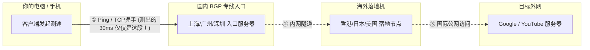

# 节点有延迟但打不开网页怎么办？订阅、节点、代理与 DNS 全维度排查

在使用代理客户端（如 Clash Verge Rev、v2rayN、Shadowrocket）时，很多用户都遇到过这样一种令人抓狂的现象：

> **“在客户端里点击测速，所有节点都显示 30~50ms 的绿色极速延迟；然而一旦打开浏览器访问 Google、YouTube 或 GitHub，网页一直转圈圈，最后提示 `无法访问此网站` 或 `连接超时`。”**

为什么**明明有延迟，却完全打不开网页**？
本文将揭开节点测速的真实原理，并按**客户端代理设置 $\rightarrow$ 系统时间 $\rightarrow$ DNS 解析 $\rightarrow$ 节点出口与分流规则** 4 个层级，带你彻底排查并解决故障。

---

## 核心真相：为什么“有延迟”不等于“能翻墙”？

很多人误以为客户端里的测速测的是“到 Google 的完整翻墙速度”。**其实完全不是！**



1. **测速测的仅仅是第一截链路**：在大部分国内中转/专线机场中，客户端的测速本质上是你的设备与**国内入口服务器**之间的 TCP 握手延迟。只要你到国内中转机的网络是通的，测速就会显示亮绿色的低延迟（30ms）。
2. **后半截链路可能已经断了**：如果国内中转机到海外落地机之间的隧道中断，或者海外落地机的 IP 被封禁，客户端测速依然显示 30ms，但实际流量根本流转不到目标网站。

了解了这个原理，我们就可以按照以下 4 个层级依次定位排查。

---

## 排查第一级：客户端设置与系统代理 (最常见)

### 1. “系统代理”开关是否真正生效？
- **现象**：开启客户端后，本地浏览器完全不走代理，或者只有少数命令行软件能用。
- **原因**：客户端虽然打开了，但没有接管操作系统的全局网络流量出口。
- **解决步骤**：
  1. 检查 Clash Verge Rev 界面的 **“系统代理” (System Proxy)** 开关是否已经点亮开启。
  2. 打开 Windows 设置 $\rightarrow$ “网络和 Internet” $\rightarrow$ “代理”，检查“使用代理服务器”开关是否自动被打开，IP 地址是否为 `127.0.0.1`，端口是否为 `7890`（或你的客户端设定端口）。
  3. 如果被其他杀毒软件或流氓软件篡改，手动关闭并重新在 Clash 中切换一次开关。

### 2. 端口冲突导致监听失败
- **现象**：客户端日志提示 `bind: address already in use` 或 `Listen error`。
- **原因**：之前的客户端异常退出，或者有其他翻墙工具（如百度网盘加速、老旧 v2rayN、Proxifier）占用了 `7890` 混合端口。
- **解决步骤**：进入客户端“设置”，将混合端口（Mixed Port）从默认的 `7890` 修改为任意未占用的端口（如 `7897` 或 `10808`），重启内核。

### 3. 需要开网页之外的应用？请开启 TUN 虚拟网卡模式
- **现象**：Chrome 网页可以打开，但 Telegram、Discord、Steam 或外服游戏无法连接。
- **原因**：许多桌面应用程序直接绕过 Windows 系统代理设置（不尊重系统代理环境变量）。
- **解决步骤**：在 Clash Verge 中安装服务模式，开启 **“TUN 模式”**。TUN 模式会创建虚拟网卡，强制接管整机所有 TCP/UDP 流量，彻底解决应用无法连网的问题。

---

## 排查第二级：系统时间严重不同步 (TLS 握手死锁)

### 故障特征
- 测速全绿，打开网页提示 `NET::ERR_CERT_DATE_INVALID` 或 TLS 证书握手超时中断。

### 故障原理
几乎所有现代翻墙协议（Shadowsocks、Vless、Trojan、Hysteria 2）都依赖极其严格的 **TLS 传输层安全协议**。
TLS 加密握手协议强制校验本地客户端时间与远端服务器时间的时钟漂移。如果你的电脑或手机主板纽扣电池没电，或者手动调错时间，**两者时间差超过 90 秒，TLS 握手将被密码学底层直接阻断！**

### 解决方案
- **Windows**：右键点击右下角时钟 $\rightarrow$ “调整日期和时间” $\rightarrow$ 确认时区为“UTC+08:00 北京/香港/重庆” $\rightarrow$ 点击 **“立即同步”** 按钮。
- **macOS**：系统设置 $\rightarrow$ “通用” $\rightarrow$ “日期与时间” $\rightarrow$ 开启“自动设置时间”。
- **手机**：进入设置打开“网络自动提供时间”。

---

## 排查第三级：DNS 污染与 Fake-IP 解析错乱

### 故障特征
- 打开国内网站（百度、淘宝）飞快，打开 Google 提示 `DNS_PROBE_FINISHED_NXDOMAIN` 或一直处于 `正在解析主机...`。

### 故障原理
Clash 默认采用高效的 **Fake-IP 模式**（即向操作系统返回 `198.18.0.x` 的保留保留虚假 IP，在核心内部再做远程 DNS 解析）。
如果本地 DNS 缓存错乱，或者家庭光猫的 DNS 实施劫持，Fake-IP 映射池与系统 DNS 缓存发生死锁，就会导致所有国外域名全部解析失败。

### 解决方案
1. **刷新本地 DNS 缓存**：
   - 打开 Windows PowerShell / CMD，执行：
     ```bash
     ipconfig /flushdns
     ```
   - 提示“已成功刷新 DNS 解析缓存”。
2. **在客户端重启内核重置 Fake-IP 数据库**：
   在 Clash Verge Rev 中点击右下角托盘图标，选择“重启内核 (Restart Kernel)”或切换一下模式（Rule $\rightarrow$ Global $\rightarrow$ Rule）。
3. **更换上游 DNS 节点**：
   在客户端 DNS 设置中，确保包含抗污染的公共 DNS，例如国内 DNS 填 `223.5.5.5`，国外 Fallback DNS 填 `https://dns.google/dns-query` 或 `1.1.1.1`。

---

## 排查第四级：节点出口与分流规则阻断

如果排除了本地客户端、时间和 DNS，问题通常在节点本身或分流规则配置上：

### 1. 分流规则把外网流量判成了“DIRECT (直连)”
- **检查方法**：打开 Clash Verge Rev 的 **“连接” (Connections)** 实时监控面板。
- 在浏览器中刷新一次 `www.youtube.com`，观察面板中该请求命中的策略组：
  - 如果显示命中规则为 `DIRECT`（直连），说明分流规则配置错误或规则集未下载完整，国内网络直连 Google 必然超时打不开！
  - **解决**：在“代理 (Proxies)”面板中，确认策略组选择的是对应节点；或者将模式临时切为 **“全局 (Global)”** 验证。如果全局模式下能打开，说明是规则集（Rule）配置缺失，重新更新订阅即可。

### 2. 节点落地机遭遇目标站点风控拦截 (Cloudflare 1020 / 403)
- **现象**：能正常打开 Google 和 YouTube，但唯独打不开 ChatGPT 或 Claude，提示 `Access Denied` 或一直在人机验证验证码死循环中。
- **原因**：节点到互联网链路通畅，但该落地机机房 IP 被目标站点的安全 WAF 拉入了黑名单。
- **解决**：在客户端内切换到其他地区或专门标有“原生 / 解锁流媒体 / AI 优化”的专属节点。

---

## 4 步排错对照与应急速查表

| 排查步骤 | 检查项目 | 正常状态 | 异常解决动作 |
| :--- | :--- | :--- | :--- |
| **步骤 1** | **系统时间** | 误差小于 5 秒 | Windows 设置中点击“立即同步” |
| **步骤 2** | **系统代理开关** | 客户端已开，系统设置代理有效 | 关闭杀软劫持，重启客户端，修改端口 |
| **步骤 3** | **模式与分流** | 规则模式正常，全局模式可用 | 将模式切为 Global 验证，排除规则失效 |
| **步骤 4** | **TUN 虚拟网卡** | 安装内核服务模式，网卡正常启用 | 重新安装 Service Mode，解决非浏览器应用断网 |

---

## 总结：黄金排查命令

对于电脑端用户，遇到有延迟打不开网页时，按下键盘 `Win + R` 输入 `cmd`，运行这条命令即可快速定位断点位置：

```bash
curl -I -x 127.0.0.1:7890 https://www.google.com
```

- **如果立即返回 `HTTP/2 200` 或 `HTTP/1.1 301`**：说明你的机场节点和客户端完全正常，问题仅在于你的**浏览器缓存或系统全局代理开关没勾上**。
- **如果返回 `Connection Refused`**：说明客户端监听失败或端口写错（检查 7890 端口）。
- **如果返回 `Operation Timed Out`**：说明该节点落地机已故障断网，请立刻在节点列表切换其他可用节点。

---

## 相关阅读与故障指南

- [机场订阅导入失败怎么办？按报错现象逐项排查手册](/blog/airport-subscription-import-failed-troubleshooting)
- [机场速度慢怎么办？如何判断问题出在哪里](/blog/airport-slow-speed-troubleshooting)
- [Clash Verge Rev 完整安装与新手配置指南](/blog/clash-verge-rev-install-subscription-guide)
- [TUN 虚拟网卡模式实操深度指南](/guides/clash-tun-setup-guide)
