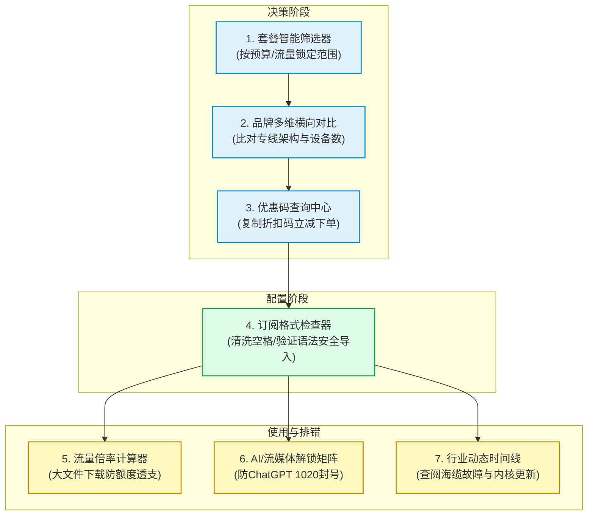

# 实用网络工具箱

  <a href="/">首页</a>
  /
  实用网络工具箱

欢迎使用「机场VPN」纯前端智能工具箱。所有工具均在**你的本地浏览器中离线计算与解析，零数据上传、不收集任何隐私与 Token**，无需登录即可免费使用，助你科学决策、杜绝买贵、避开流量与风控陷阱。

---

## 8 大实用工具导航

  <!-- 1. Plan Filter -->
  

    

      🔍
      

        <h3 class="tool-portal-title"><a href="/tools/plan-filter">机场套餐智能筛选器</a></h3>
        主流精选品牌方案
      

    

    

      按预算区间（&lt;¥15至&gt;¥60）、月流量额度、支付周期与专线类型多维动态组合筛选，实时算出每 GB 实际单价。
    

    <a href="/tools/plan-filter" class="tool-portal-btn">进入筛选器 →</a>
  

  <!-- 2. Multiplier Calculator -->
  

    

      🧮
      

        <h3 class="tool-portal-title"><a href="/tools/multiplier-calculator">机场流量倍率计算器</a></h3>
        避坑与省流神器
      

    

    

      搞懂 0.2x 与 2.0x 节点真相！推算套餐实际物理可用容量，以及在 YouTube 4K、短视频与 Steam 下载等真实场景下的持续时长。
    

    <a href="/tools/multiplier-calculator" class="tool-portal-btn">进入倍率计算器 →</a>
  

  <!-- 3. Coupon Center -->
  

    

      🎟️
      

        <h3 class="tool-portal-title"><a href="/tools/coupon-center">机场优惠码查询中心</a></h3>
        官方核验 7折~9折
      

    

    

      汇聚精选 9 大主力机场官方专属折扣优惠码，支持一键点击复制，结账立省 10%~30%，直达官网与上手教程。
    

    <a href="/tools/coupon-center" class="tool-portal-btn">查询官方优惠券 →</a>
  

  <!-- 4. Client Connection & Diagnostic Center -->
  

    

      🩺
      

        <h3 class="tool-portal-title"><a href="/tools/subscription-checker">客户端连接与网络诊断中心</a></h3>
        专属客户端体检 · 本地时钟
      

    

    

      专属客户端登录超时、国内网页卡死或节点测速全红？快速体检系统时钟偏差、6 大高频故障一键自救及传统订阅排错。
    

    <a href="/tools/subscription-checker" class="tool-portal-btn">进入诊断体检中心 →</a>
  

  <!-- 5. Brand Comparator -->
  

    

      ⚖️
      

        <h3 class="tool-portal-title"><a href="/tools/brand-comparator">机场品牌多维对比工具</a></h3>
        参数横向矩阵比对
      

    

    

      自由添加 2~4 家品牌并排比对物理专线、起步门槛、设备数限制、流媒体解锁表现，支持只看差异项异项。
    

    <a href="/tools/brand-comparator" class="tool-portal-btn">进入品牌对比工具 →</a>
  

  <!-- 6. Unlock Status Checker -->
  

    

      🤖
      

        <h3 class="tool-portal-title"><a href="/tools/unlock-checker">AI / 流媒体解锁查询</a></h3>
        ChatGPT/Claude/Netflix
      

    

    

      降低 1020 阻断与封号风险！查询各大机场对 OpenAI、Claude、Netflix 原生支持评级与推荐落地专线地区。
    

    <a href="/tools/unlock-checker" class="tool-portal-btn">查询解锁状态矩阵 →</a>
  

  <!-- 7. Maintenance Timeline -->
  

    

      📢
      

        <h3 class="tool-portal-title"><a href="/tools/timeline">行业动态时间线</a></h3>
        内核更新 · 行业动态
      

    

    

      客户端报错或 AI 账号异常？对照时间线查看 Mihomo 内核与客户端更新、系统故障、平台风控与促销动态。
    

    <a href="/tools/timeline" class="tool-portal-btn">查看动态时间线 →</a>
  

  <!-- 8. Free US Apple ID -->
  

    

      🍎
      

        <h3 class="tool-portal-title"><a href="/tools/free-us-apple-id">免费美区 Apple ID 共享</a></h3>
        小火箭 · Stash 下载
      

    

    

      国区下载不到小火箭、Stash？5 分钟免费注册自己的美区 Apple ID（不用信用卡），或使用共享账号入口，附安全使用须知。
    

    <a href="/tools/free-us-apple-id" class="tool-portal-btn">获取美区 Apple ID →</a>
  

---

## 为什么打造这套工具箱？（工程设计理念）

网络加速工具行业长期存在**严重的信息不对称与夸大营销**。许多普通用户在挑选和使用服务时面临以下三大痛点：

1. **暗坑丛生，算不清真实成本**：服务商宣传的“超低价”往往暗藏极低流量限制或超高倍率扣费，看似便宜，实际每 GB 成本高昂；
2. **排错无门，遇故障只能干着急**：导入订阅报错、节点超时、AI 账号受限时，用户缺乏诊断工具，无法区分到底是自己电脑问题、运营商网络故障还是服务商机房维护；
3. **隐私顾虑，担心 Token 泄露**：市面上充斥着各种第三方在线订阅转换工具，不少存在偷换节点或记录用户私人 Token 的安全隐患。

为此，我们遵循 **「三项绝对工程原则」** 打造了本套工具箱：
- 🛡️ **严格本地计算**：所有工具的代码均由纯前端 JavaScript 驱动，在用户浏览器沙箱中闭环运行，零网络外发请求，确保订阅凭据安全无虞；
- 📐 **客观量化标准**：不搞主观臆断，所有套餐折算、倍率推导与参数比对均基于明确数学公式与可验证技术规格；
- 🚀 **开箱即用免登录**：无需注册、不插播强制弹窗，直达核心计算与排错功能。

---

## 8 大工具全生命周期协同工作流

各个工具并非孤立存在，而是覆盖了用户从**“选型决策”**到**“日常使用”**再到**“故障排查”**的完整链路：

---

## 快速体验：套餐智能筛选

<PlanFilter />

---

## 推荐阅读与深度技巧

- [机场和 VPN 有什么区别？新手怎么选](/blog/vpn-vs-airport-difference)
- [机场怎么选？购买前必须检查的这几个项目](/blog/how-to-choose-airport-checklist)
- [月付、年付和不限时流量包怎么选？按实际使用量计算真实费用](/blog/billing-cycles-comparison-guide)
- [全品牌新手跨平台上手教程大全](/guides/)

