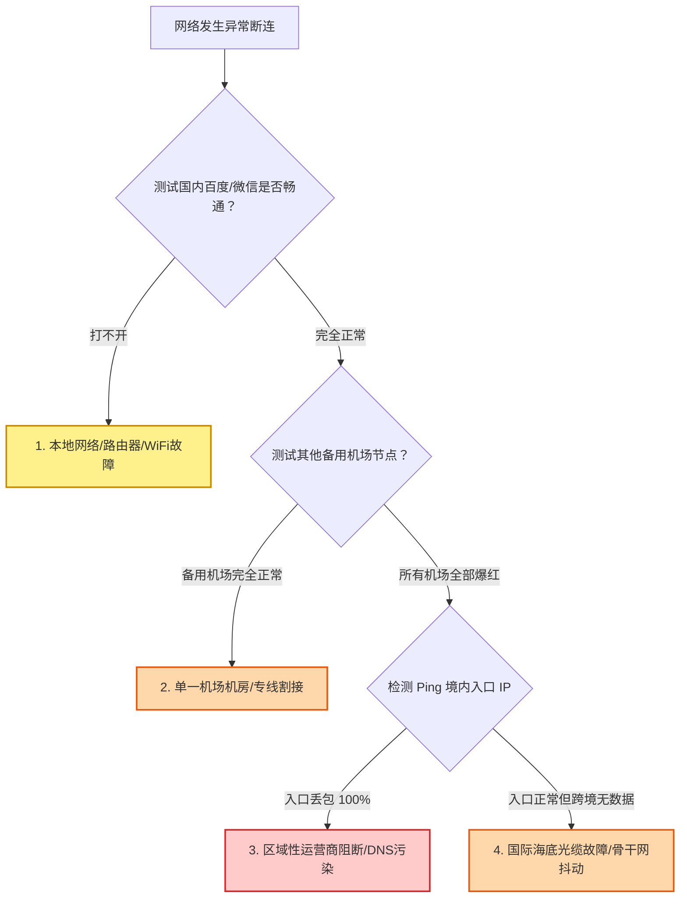

# 网络工具与行业动态时间线

  <a href="/">首页</a>
  /
  <a href="/tools/">实用工具箱</a>
  /
  行业动态时间线

网络世界瞬息万变。开源内核协议演进、Windows 补丁冲突、国际海缆突发中断、海外 AI 平台风控升级以及各大品牌节点的上新与调价，时刻影响着每个人的日常连接体验。本时间线汇总记录行业重大技术节点与关键动态，帮助你第一时间掌握前沿变动并做好应对准备。

---

<MaintenanceTimeline />

---

## 为什么需要「行业动态时间线」？（核心作用解析）

在跨境网络与代理工具的使用过程中，用户最常面临的困扰就是**“突发状况缺乏信息透明度”**：

1. **断网时的盲目恐慌**：某天早上打开电脑突然所有节点爆红超时，很多用户第一反应往往是“是不是机场跑路了？”，随即在各个技术群里焦躁发问。实际上，很可能是国际海底光缆（如 APG、AAG）发生了物理断纤，或者当地省份运营商正在进行定期的网络割接。
2. **操作系统补丁冲突**：微软 Windows 或苹果 macOS 在发布月度安全更新后，曾多次出现导致系统底层 TUN 虚拟网卡驱动崩溃、或者 L2TP/IPsec 连接报错的系统级 Bug。不知道背景的用户可能会反复重装系统或误删配置文件。
3. **开源生态与协议更替**：从经典的 Clash 核心停更，到 Mihomo (Clash Meta) 崛起，再到 Sing-box 与 Hysteria2 协议普及，客户端版本更新往往伴随着旧语法的废弃。不及时跟进动态，很容易在拉取新配置时频繁崩溃。

**本工具的核心作用**，就是建立一个**客观、中立、高时效性的行业技术事件与动态记录档案库**。无论是协议演进、系统故障、海缆维修进展，还是各大品牌的官方促销与架构升级，都能在此找到权威记录与对应的工程级自救指引。

---

## 跨境网络三大常见异常分类与定责判定

当网络连接突然中断或丢包剧增时，可以通过以下逻辑快速定位责任层级：

### 1. 物理海底光缆与骨干网故障（自然灾害与施工破坏）
- **现象**：大部分日韩、美西节点延迟瞬间翻倍（例如由 40ms 飙升至 200ms），丢包率陡增。
- **背景**：巴士海峡地震、台风或渔船拖网作业可能导致海底光纤受损。维修船通常需要 2 周至 1 个月时间出海打捞抢修。在此期间，服务商需紧急调度昂贵的绕行备用带宽。

### 2. 本地系统补丁与虚拟网卡冲突
- **现象**：更新 Windows 或 macOS 后，客户端开启「TUN 模式」或「系统代理」即刻导致整机彻底断网。
- **应对方案**：在时间线中查阅对应的系统 KB 补丁编号，卸载冲突补丁或更新 Clash Verge Rev 至最新预发布版以适配新驱动。

### 3. 服务商入口机房定期割接
- **现象**：深夜 02:00~06:00 期间特定省份入口临时断开。
- **背景**：正规 BGP 机房为保障带宽冗余，会定期升级物理交换机。通常会在官方公告中提前通知并在数小时内恢复。

---

## 突发断连应急自救四步法

如果遭遇突发断连，请保持冷静并按照以下顺序自查：

1. **第一步：切换至备用品牌线路**：
   迅速在客户端中将活动代理组切换至备用服务商节点。如果备用线路正常，说明问题仅局限于单一品牌，无需重装本地软件。
2. **第二步：更新订阅配置**：
   在客户端中右键点击订阅 -> 选择「强制更新订阅」。服务商可能已经通过动态调度下发了绕过阻断的新入口 IP。
3. **第三步：校准本地系统时钟**：
   打开操作系统设置，强制同步北京时间。时间偏差超过 90 秒会导致 TLS 安全握手彻底失败。
4. **第四步：刷新本地 DNS 缓存**：
   在 Windows 终端中运行 `ipconfig /flushdns`，清除操作系统缓存的旧 DNS 解析记录。

---

## 常见疑问解答 (FAQ)

### Q1：时间线中的信息来源是什么？
所有动态均来自于官方开源项目仓库（如 GitHub Clash Verge Rev / Sing-box Release）、微软/苹果官方安全补丁知识库、国际海缆监控平台（Submarine Cable Map）以及各大主流机场官方频道发布的技术维护公告。

### Q2：为什么建议用户关注内核版本更新？
新一代代理协议（如 VLESS Reality 与 Hysteria2）对抗主动探测和流量特征审查的能力显著优于数年前的旧协议。关注内核更新并及时升级客户端，是保持网络长期稳定最有效且低成本的方式。

---

## 协同实用工具推荐

- [订阅链接格式检查器：排查客户端导入失败与语法错误](/tools/subscription-checker)
- [品牌横向多维对比工具：比对各大品牌专线配置与起步门槛](/tools/brand-comparator)
- [机场套餐智能筛选器：按预算与真实单价挑选最佳方案](/tools/plan-filter)
- [AI / 海外流媒体解锁查询：检测各大品牌 ChatGPT 与流媒体支持](/tools/unlock-checker)
