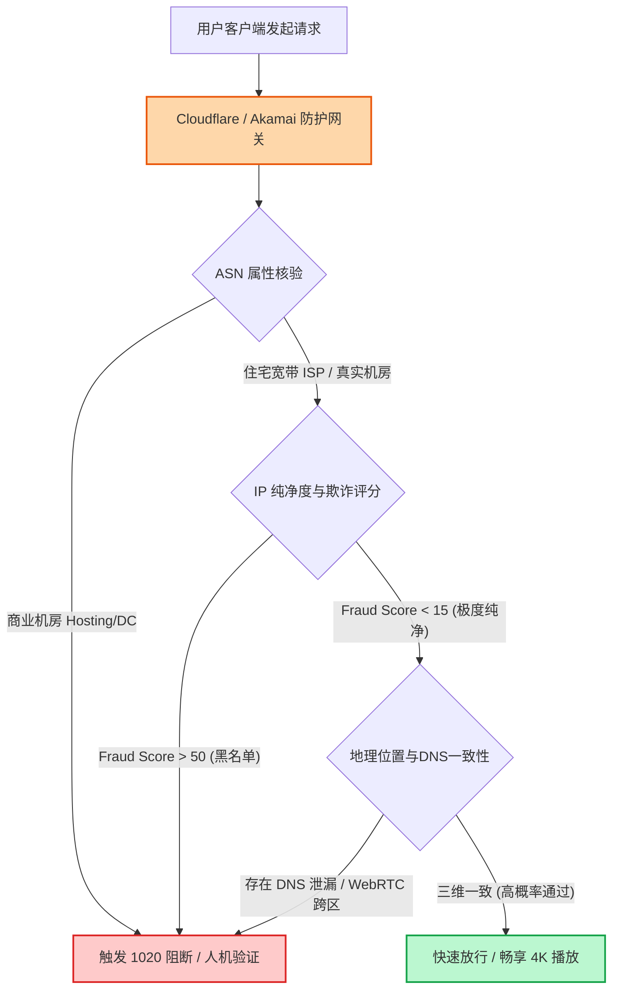

# AI / 海外流媒体解锁查询中心

  <a href="/">首页</a>
  /
  <a href="/tools/">实用工具箱</a>
  /
  AI与流媒体解锁查询

登录 ChatGPT 频繁遭遇 `1020 阻断` 或 `Access Denied`？注册 Claude 刚输入手机号就被提示停用？打开 Netflix 却搜不到非自制版权剧？本中心汇总了主流一线机场在 **流媒体全平台（Netflix / Disney+ / HBO）与顶级 AI 服务（ChatGPT / Claude）** 上的官方支持情况与解锁架构说明，助你精准避坑。

---

<UnlockStatusChecker />

---

## 为什么需要「AI / 流媒体解锁查询中心」？（核心作用解析）

随着海外互联网平台对跨国风控与版权地域保护力度的持续收紧，普通代理服务面临着前所未有的访问阻碍：

1. **机房广播 IP 严重污染**：许多廉价中转服务使用的服务器 IP 属于大型云服务商（如 AWS、DigitalOcean、Linode、OVH 等）的机房 IP 段（Datacenter IP）。在 MaxMind、IP2Location 等国际安全数据库中，这类 IP 的风险评分（Fraud Score）极高，几乎被 Cloudflare 与 OpenAI 列入了全自动阻断黑名单。
2. **Netflix 自制剧锁区假象**：很多用户以为能打开 Netflix 网站就代表“解锁了”，实际上只能看到 Netflix 自身投资拍摄的全球自制剧（如《怪奇物语》），而绝大部分具有严格地域版权保护的第三方版权影视剧（如吉卜力动画、当地热播剧等）全部被隐藏。
3. **Claude 极度苛刻的风控机制**：Anthropic 旗下的 Claude 对代理环境的检测标准堪称严苛。一旦检测到连接来源为广播 IP、节点网络频繁跳动或存在 WebRTC / DNS 泄漏，账号会在几小时内直接触发永久封禁。

**本工具的核心作用**，就是将各个主流加速品牌在流媒体分流与 AI 原生住宅 IP 方面的实际支持能力透明化，告诉你哪些品牌部署了专门的解锁中继、哪些节点能够高概率稳定访问 ChatGPT 与 Claude，避免因为买错节点导致重要账号被无辜封禁。

---

## 流媒体与 AI 风控系统的检测原理深度剖析

为了有效规避被阻断或封号，必须理解平台是如何识别代理连接的：

### 1. ASN 属性与 IP 类型识别
国际互联网地址分配机构将 IP 分为两类：
- **Hosting / Transit（数据中心 IP）**：服务器部署在云端机房中，正常居民通常不会用这类 IP 刷剧或聊天。
- **ISP / Residential（住宅家庭宽带 IP）**：由海外当地电信运营商（如 AT&T、Verizon、Comcast 等）分配给家庭居民的宽带。
**应对策略**：优质机场通常通过反向代理将流媒体请求调度至专用的 **原生 ISP / 住宅解锁机** 上完成解密，从而绕过风控检测。

### 2. Cloudflare Turnstile 与 1020 规则集
Cloudflare 通过分析访问者的 TCP 指纹、TLS 握手特征（JA3/JA4 指纹）、IP 历史请求频率进行行为建模。如果同一机房 IP 在短时间内有上千个不同用户同时访问 ChatGPT，系统便会自动判定为爬虫或共享代理，直接弹窗阻断。

---

## 保证 AI 与流媒体长期稳定的 4 大实战准则

1. **固定专属节点，严禁频繁“跨国瞬移”**：
   使用 ChatGPT 或 Claude 时，尽量固定使用同一个优质原生节点（例如美西或日本）。切忌在 10 分钟前用香港节点登录，10 分钟后又切换到美国或英国，极易触发异地登录异常风控。
2. **开启客户端「域名智能分流」，杜绝 DNS 泄漏**：
   在 Clash Verge Rev 或 Shadowrocket 中，务必使用官方内置的完整分流规则。确保访问 OpenAI 相关域名时走专线，而国内请求直连，并在设置中开启 **DNS 伪装防泄漏（DoH / DoT）**。
3. **保持浏览器独立指纹环境**：
   建议为 ChatGPT / Claude 专门新建一个干净的 Chrome 独立用户配置（Profile），关闭不必要的浏览器广告拦截插件，使用无痕模式或者专用环境登录。
4. **注意支付与绑定信用卡的国家匹配**：
   订阅 ChatGPT Plus 或 Claude Pro 时，所使用的银行卡账单地址最好与当前代理节点的物理所在国保持一致，可大幅提高扣款成功率并降低拒付风控。

---

## 常见疑问解答 (FAQ)

### Q1：为什么有些节点昨天还能用 ChatGPT，今天突然提示“当前地区不支持”？
这是因为 OpenAI 会定期更新风控 IP 黑名单。如果该节点的机房出口被其他滥用用户过度并发请求，该 IP 可能会被 OpenAI 临时拉黑 24~48 小时。优质机场通常具备**多出口 IP 池轮换机制**，隔天即可自动恢复，或者你可以临时切换到同品牌的其他可用备用节点。

### Q2：使用“解锁专用节点”会比普通节点更慢吗？
通常不会明显变慢。因为解锁技术大多采用**流媒体 DNS 分流（SNI Proxy）**：只有在初始视频版权鉴权或握手登录的一瞬间，流量会经过解锁服务器验证；而在实际的大流量视频数据流传输阶段，依然走的是高速专线直达链路，因此可以充分保障 4K 播放的吞吐带宽。

---

## 协同实用工具推荐

- [机场套餐智能筛选器：按预算与真实单价挑选最佳方案](/tools/plan-filter)
- [品牌横向多维对比工具：比对各大品牌专线配置与起步门槛](/tools/brand-comparator)
- [订阅链接格式检查器：排查客户端导入失败与语法错误](/tools/subscription-checker)
- [网络工具与行业动态时间线：追踪各大品牌促销与线路变更](/tools/timeline)
